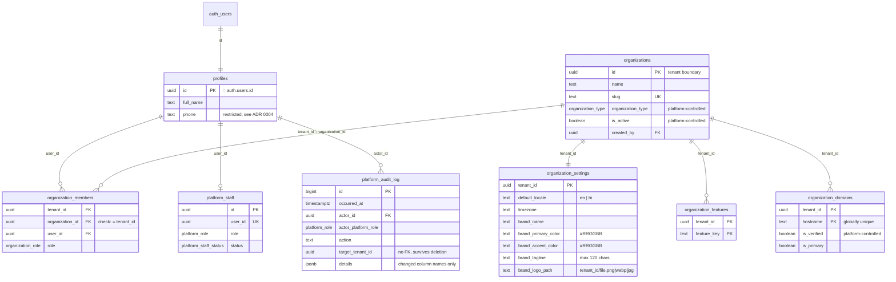

# Data model

Current schema: the identity, tenancy, and platform foundation. Farm
operations tables (regions, villages, farmers, fields, bookings, pilots,
drones) and satellite observations are not built yet. Add them here when
their migrations land.

## Entity relationship diagram

## Tenant-owned vs global tables

| Table                   | Ownership     | Notes                                                                                                       |
| ----------------------- | ------------- | ----------------------------------------------------------------------------------------------------------- |
| `organizations`         | Tenant record | One organization = one tenant in the MVP.                                                                   |
| `organization_members`  | Tenant-owned  | `tenant_id = organization_id` check enables tenant-consistent composite FKs later.                          |
| `organization_settings` | Tenant-owned  | One row per tenant, created by provisioning.                                                                |
| `organization_features` | Tenant-owned  | Presentation and availability only. Never an authorization control.                                         |
| `organization_domains`  | Tenant-owned  | Hostnames are globally unique. Verification is platform-only.                                               |
| `profiles`              | **Global**    | Identity is shared across tenants. Visibility comes from shared membership (`profiles_share_organization`). |
| `platform_staff`        | **Global**    | Platform roles, separate from tenant roles (ADR 0001).                                                      |
| `platform_audit_log`    | **Global**    | Append-only platform audit trail (ADR 0005). Not tenant-owned; references tenants by ID without an FK.      |

## Roles

- **Organization roles** (`organization_role`): `organization_admin`,
  `regional_admin`, `mitra`, `farmer`, `pilot`. The legacy `super_admin` and
  `admin` values are blocked by a constraint (ADR 0002).
- **Platform roles** (`platform_role`): `platform_owner`, `system_admin`,
  `developer`, `support`.

## Access summary

| Table                   | Read                                                                            | Write                                                                                                                |
| ----------------------- | ------------------------------------------------------------------------------- | -------------------------------------------------------------------------------------------------------------------- |
| `profiles`              | Self and members of a shared tenant (name only). Phone via `get_profile_phone`. | Self: `full_name` only.                                                                                              |
| `organizations`         | Members; platform owner/system admin.                                           | Org admin: name. Platform staff: everything. Trigger blocks tenant changes to type, status, slug, and audit columns. |
| `organization_members`  | Self; org/regional admins of the tenant; platform owner/system admin.           | `add_organization_member` RPC. Org admin updates/deletes others. Regional admin: operational roles only.             |
| `organization_settings` | Members; platform owner/system admin.                                           | Org admin and platform staff: update.                                                                                |
| `organization_features` | Members; platform owner/system admin.                                           | Org admin; platform staff.                                                                                           |
| `organization_domains`  | Members; platform owner/system admin.                                           | Org admin: insert unverified, delete. Platform staff: everything.                                                    |
| `platform_staff`        | Self; platform owner/system admin.                                              | `manage_platform_staff` RPC. Only an owner can grant or modify `platform_owner`.                                     |
| `platform_audit_log`    | Platform owner/system admin.                                                    | Nobody directly. Written only by audit triggers and `log_platform_tenant_access`.                                    |

## Functions

| Function                                                                             | Executable by                                  | Purpose                                                                       |
| ------------------------------------------------------------------------------------ | ---------------------------------------------- | ----------------------------------------------------------------------------- |
| `is_organization_member`, `has_organization_role`, `profiles_share_organization`     | authenticated                                  | RLS helpers.                                                                  |
| `is_platform_role`, `is_platform_owner`, `is_system_admin`, `is_platform_staff`      | authenticated                                  | Platform RLS helpers.                                                         |
| `add_organization_member`                                                            | authenticated                                  | Role-checked membership creation.                                             |
| `provision_customer_organization`                                                    | authenticated (owner/system admin enforced)    | Creates organization, settings, first admin, and features in one transaction. |
| `manage_platform_staff`                                                              | authenticated (owner/system admin enforced)    | Staff role and status changes.                                                |
| `bootstrap_platform_owner`                                                           | database administrators only                   | One-time first owner.                                                         |
| `get_profile_phone`                                                                  | authenticated                                  | Phone visibility rules (ADR 0004).                                            |
| `get_public_branding`                                                                | anon, authenticated                            | Brand for a verified hostname (ADR 0003).                                     |
| `log_platform_tenant_access`                                                         | authenticated (active platform staff enforced) | Records a platform staff view of a tenant (ADR 0005).                         |
| `write_platform_audit`, `audit_platform_tenant_write`, `audit_platform_staff_change` | nobody (triggers only)                         | Audit writers.                                                                |
| `protect_platform_controlled_organization_fields`                                    | nobody (trigger only)                          | Blocks tenant changes to type, status, slug, and audit columns.               |

Every `SECURITY DEFINER` function uses `set search_path = ''` and has
`execute` revoked from `public`, plus from `anon` unless listed.

## Storage

| Bucket         | Public     | Contents                                                              | Write access                                                       |
| -------------- | ---------- | --------------------------------------------------------------------- | ------------------------------------------------------------------ |
| `brand-assets` | Yes (read) | Tenant logos at `<tenant_id>/<file>`. PNG, WebP, or JPEG, max 512 KB. | Platform owner and system admin only (`storage.objects` policies). |

## Spatial data

PostGIS is enabled (`20261118180523_enable_postgis.sql`). No spatial columns
exist yet. Field points and boundaries will use SRID 4326 with GiST indexes.

## Generated types

`apps/web/src/types/database.types.ts` is generated. After any migration, run
`npm run db:types` and commit the result. CI fails if it is out of date.
